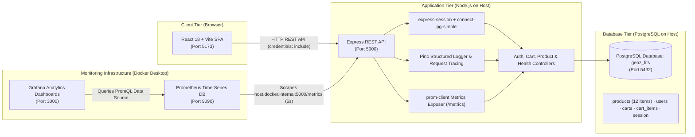

# GenZ Fits (VÉLORA Collection) — College E-Commerce Lab Assignment (Parts 1, 2 & 3)

> **Course:** MNIT Programming Lab  
> **Assignment:** Lab Assignment 9 — Full-Stack E-Commerce Product Catalog, Authentication, Shopping Cart & Observability  
> **Brand & Theme:** GenZ Fits · VÉLORA Contemporary Atelier (Minimalist Tailoring, Streetwear & Architectural Silhouettes)  
> **Color Scheme:** Warm Ivory (`#faf8f5`), Pitch Black (`#111111`), Subtle Taupe (`#e6dfd5`), and Deep Burgundy (`#741221`)  
> **Currency:** Indian Rupee (INR — `₹`)

---

## 1. System Architecture

GenZ Fits strictly adheres to a clean **3-Tier Architecture** augmented with an asynchronous **Observability & Monitoring Infrastructure**:



---

## 2. Tech Stack

- **Frontend:** React 18, Vite, Vanilla CSS (custom design system with CSS custom properties), Lucide React (minimalist iconography).
- **Backend:** Node.js, Express 4.x, CORS, Dotenv, `bcryptjs` (password hashing), `express-session` (session security).
- **Logging & Tracing:** `pino`, `pino-http` (JSON structured logging with sensitive field redaction and `x-request-id` tracing).
- **Database & Session Store:** PostgreSQL 14+, `pg` (node-postgres connection pool), `connect-pg-simple` (persistent sessions), `node-pg-migrate` (safe schema migrations).
- **Monitoring & Observability:** Prometheus v2.51, Grafana 10.4, `prom-client`, Docker Compose.
- **Design Philosophy:** Editorial luxury fashion layout, distinctive typography (`Cormorant Garamond` serif display paired with `Plus Jakarta Sans` clean body), warm ivory canvas backgrounds, black typography, subtle taupe architectural borders, and deep burgundy accents.

---

## 3. Directory Structure

```text
e-commerce-lab/
├── docker-compose.yml              # Prometheus & Grafana container orchestration
├── package.json                    # Root scripts (install, dev, migrate, test, demo)
├── README.md                       # Complete multi-part lab documentation
├── prometheus/                     # Prometheus scrape configuration
│   └── prometheus.yml              # Scrapes host.docker.internal:5000/metrics
├── grafana/                        # Automated Grafana provisioning & dashboards
│   ├── provisioning/
│   │   ├── datasources/
│   │   │   └── datasource.yml      # Connects Grafana to Prometheus automatically
│   │   └── dashboards/
│   │       └── dashboard.yml       # Provisions dashboard folder & provider
│   └── dashboards/
│       └── velora-ecommerce-dashboard.json # Preconfigured 6-panel performance dashboard
├── screenshots/                    # Submission visual verification screenshots
│   ├── 01-product-listing.png
│   ├── 02-product-details.png
│   ├── 03-search-and-filter.png
│   ├── 04-empty-state.png
│   └── README.md                   # Visual verification checklist & guidelines
├── database/                       # PostgreSQL SQL scripts
│   ├── schema.sql                  # Original products table DDL & indexes
│   ├── seed.sql                    # 12 contemporary fashion products seed data
│   └── init-db.js                  # Standalone forwarder runner
├── backend/                        # Node.js + Express REST API
│   ├── package.json
│   ├── .env.example                # Example environment variables (placeholders only)
│   ├── .env                        # Local development environment configuration
│   ├── migrations/                 # node-pg-migrate scripts (session, users, carts, items)
│   │   ├── 1795081000001_create-session-table.js
│   │   ├── 1795081000002_create-users-table.js
│   │   └── 1795081000003_create-carts-and-cart-items-tables.js
│   └── src/
│       ├── server.js               # Express application entry point (Port 5000)
│       ├── config/
│       │   ├── db.js               # PostgreSQL connection pool & health checks
│       │   ├── logger.js           # Pino structured logger & redaction
│       │   ├── metrics.js          # Prometheus metrics & route normalizer
│       │   └── initDb.js           # Database reset & seed executor
│       ├── controllers/
│       │   ├── authController.js   # User registration, login, logout & session logic
│       │   ├── cartController.js   # Cart CRUD & PostgreSQL price/stock calculations
│       │   └── productController.js# Catalog query execution, filters & sorting
│       ├── middleware/
│       │   ├── auth.js             # requireAuth and requireRole middleware (401/403)
│       │   ├── errorHandler.js     # Global error handler with structured exception logging
│       │   └── validator.js        # Input validation for products & authentication
│       ├── routes/
│       │   ├── apiRoutes.js        # Main router (/api/health, /api/auth, /api/cart, /api/products)
│       │   ├── authRoutes.js       # Auth endpoints (/register, /login, /logout, /me)
│       │   ├── cartRoutes.js       # Cart endpoints (guarded by requireAuth)
│       │   └── productRoutes.js    # Product catalog routes
│       ├── scripts/
│       │   ├── verifyDb.js         # Verification of 12 products & applied migrations
│       │   ├── testAuth.js         # 11-step authentication automated test runner
│       │   ├── testFullIntegration.js # 14-step integration test runner
│       │   └── generateTraffic.js  # Live traffic generator for Grafana demonstration
│       └── data/
│           └── initialProducts.js  # 12 seed fashion products dataset & fallback
└── frontend/                       # React 18 + Vite SPA client
    ├── package.json
    ├── vite.config.js              # Vite server & reverse-proxy configuration
    ├── index.html                  # HTML shell with Google Fonts & metadata
    └── src/
        ├── index.css               # Design system & responsive styles
        ├── main.jsx                # React DOM mount point
        ├── App.jsx                 # Stateful catalog & wardrobe orchestrator
        ├── services/
        │   └── api.js              # Fetch client sending credentials: 'include'
        └── components/
            ├── Navbar.jsx          # Live database status, auth pill & wardrobe badge
            ├── HeroBanner.jsx      # Editorial header with CTA
            ├── SearchAndFilter.jsx # Debounced search, category pills & sort dropdown
            ├── ProductGrid.jsx     # Responsive product card layout
            ├── ProductCard.jsx     # Garment card with quick "Add to Wardrobe" action
            ├── ProductDetailModal.jsx # Detail modal with interactive size & quantity selector
            ├── AuthModal.jsx       # Modal for Sign In and Registration
            ├── CartPage.jsx        # Curated wardrobe cart page with quantity controls & totals
            ├── StatusStates.jsx    # Shimmer skeleton, empty state, error state
            └── Footer.jsx          # Academic metadata & tech stack badges
```

---

## 4. Prerequisites

1. **Node.js** (v18.0.0 or higher recommended, verified on v24+)
2. **npm** (v9.0.0 or higher)
3. **PostgreSQL** (v14.0 or higher) — *Runs natively on host port 5432.*
4. **Docker Desktop** (for Windows / macOS / Linux) — *Runs Prometheus & Grafana monitoring containers.*

---

## 5. PostgreSQL Database Setup & Migrations

### Step A: Start PostgreSQL Service
- **Windows PowerShell:**
  ```powershell
  Start-Service postgresql*
  ```
- **macOS / Linux:**
  ```bash
  sudo systemctl start postgresql
  ```

### Step B: Create Database (One-time)
```bash
createdb -U postgres genz_fits
```

### Step C: Apply Database Migrations (Zero Data Loss)
Run `node-pg-migrate` to create `session`, `users`, `carts`, and `cart_items` tables while preserving all 12 products:
```bash
npm run migrate:up
```

Verify that all tables and products are intact:
```bash
npm run db:verify
```

---

## 6. How to Run the Application & Monitoring

### 6.1 Application URLs & Credentials

| Service | Local URL | Description | Default Credentials |
| :--- | :--- | :--- | :--- |
| **Frontend Client** | `http://localhost:5173` | React 18 + Vite Luxury Storefront | *Register in UI* |
| **Backend REST API** | `http://localhost:5000` | Express REST API | N/A |
| **API Health Check** | `http://localhost:5000/api/health` | PostgreSQL status & uptime | N/A |
| **Backend Metrics** | `http://localhost:5000/metrics` | Prometheus exposition format | N/A |
| **Prometheus Server** | `http://localhost:9090` | Time-series scraper & PromQL | None |
| **Grafana Dashboards**| `http://localhost:3000` | Preconfigured Visual Dashboards | `admin` / `admin` *(or view without login)* |

---

### 6.2 Running the Application

Open separate terminal windows:

#### Terminal 1: Backend Server (Port 5000)
```bash
npm run dev:backend
```
*(Runs on `http://localhost:5000`)*

#### Terminal 2: Frontend Client (Port 5173)
```bash
npm run dev:frontend
```
*(Runs on `http://localhost:5173`)*

---

### 6.3 Running Monitoring Infrastructure (Docker Compose)

Start Prometheus and Grafana containers:
```bash
docker compose up -d
```

Check container status:
```bash
docker compose ps
```

View live container logs:
```bash
docker compose logs -f
```

Stop monitoring containers:
```bash
docker compose down
```
*(To stop and remove persistent volumes: `docker compose down -v`)*

---

## 7. How to Demonstrate Live Traffic & Telemetry

To populate Grafana with live real-time metrics, run the automated traffic simulator:

```bash
npm run demo:traffic
```

This simulator generates 15 waves of:
1. Normal catalog browsing, filtering, and searches.
2. User registrations, logins, and session regenerations.
3. Adding fashion pieces to wardrobes, updating quantities, and removing items.
4. **Controlled Failures** (400 Bad Request, 401 Unauthorized, 404 Not Found) to demonstrate how Grafana tracks error rates and status spikes.

Open **`http://localhost:3000`** in your browser to watch the 6 preconfigured panels populate in real time!


---

## 7. REST API Documentation

### 7.1 Health Check
- **Endpoint:** `GET /api/health`
- **Response `200 OK`:**
  ```json
  {
    "success": true,
    "status": "ok",
    "service": "genz-fits-api",
    "collection": "VÉLORA Contemporary Fashion",
    "uptime": "128s",
    "timestamp": "2026-10-29T10:00:00.000Z",
    "database": {
      "type": "PostgreSQL",
      "configuredHost": "localhost",
      "connected": true,
      "statusMessage": "Connected to PostgreSQL database"
    }
  }
  ```

### 7.2 Get Products Catalog
- **Endpoint:** `GET /api/products`
- **Query Parameters:**
  | Parameter | Type | Default | Description |
  | :--- | :--- | :--- | :--- |
  | `category` | string | `all` | Filter by category: `Jackets & Outerwear`, `Shirts & Tops`, `Trousers & Bottoms`, `Dresses & Silhouettes`, `Sneakers & Footwear`, `Accessories & Leather` |
  | `search` | string | `""` | Search query matching garment name or description |
  | `sortBy` | string | `newest` | `newest`, `price_asc`, `price_desc`, `rating`, `name_asc`, `name_desc` |
- **Response `200 OK`:**
  ```json
  {
    "success": true,
    "count": 12,
    "data": [
      {
        "id": 1,
        "name": "Oversized Wool Trench Coat",
        "slug": "oversized-wool-trench-coat",
        "category": "Jackets & Outerwear",
        "description": "Double-breasted tailored trench coat woven from a heavyweight virgin wool blend...",
        "price": "6999.00",
        "stock": 18,
        "image_url": "https://images.unsplash.com/photo-1544022613-e87ca75a784a?auto=format&fit=crop&w=1000&q=80",
        "rating": "4.90",
        "reviews_count": 88,
        "material": "70% Virgin Wool, 30% Polyamide (Cupro Satin Lining)",
        "dimensions": "Sizes: XS, S, M, L, XL",
        "origin": "Vélora Atelier Milano",
        "in_stock": true
      }
    ]
  }
  ```

### 7.3 Get Single Product Details
- **Endpoint:** `GET /api/products/:id`
- **Route Parameters:** `id` (Positive Integer)
- **Response `200 OK`:** Single product JSON object.
- **Response `404 Not Found`:** `{ "success": false, "error": "Product not found with ID: 999" }`
- **Response `400 Bad Request`:** `{ "success": false, "error": "Invalid product ID. The ID must be a positive integer." }`

---

## 8. Frontend Features & Aesthetic Direction

1. **Brand Identity:** **GENZ FITS** featuring the **VÉLORA Collection** (contemporary atelier).
2. **Editorial Hero Section:** Features the bold headline *"Discover Your Style. Tailored for the new era."* and an interactive **"Explore Collection"** button that smoothly scrolls to the catalog.
3. **Color Palette:** Warm Ivory (`#faf8f5`), Pitch Black typography (`#111111`), Subtle Taupe structural lines (`#e6dfd5`), and Deep Burgundy accents (`#741221`).
4. **INR Currency Formatting:** All prices formatted consistently in Indian Rupees (`₹2,799`, `₹6,999`).
5. **Interactive Controls:**
   - 300ms debounced live search with one-click clear button.
   - Category filter pills for 6 distinct fashion categories.
   - Sort dropdown for pricing, ratings, and alphabetical order.
6. **Garment Detail View:** Technical specifications table displaying fabrication/materials, sizing and fit, atelier origin, and collection SKU (`GZF-XXXX`).
7. **Three-State UX:** Shimmer skeletons, empty state with filter reset, and API error retry banner.

---

## 9. Part 2: Authentication & Authorization

GenZ Fits implements enterprise-grade, session-based authentication backed by PostgreSQL persistent storage.

### 9.1 Authentication Architecture
- **Password Security:** Salted hashes generated via `bcryptjs` with 10 salt rounds. Plaintext passwords or hashes are **never returned** by any API endpoint.
- **Session Store:** Persistent sessions stored in PostgreSQL using `connect-pg-simple` in the `session` table. Survives server restarts.
- **Session Hardening:** Session IDs are regenerated upon login (`req.session.regenerate()`) to prevent session fixation attacks.
- **Cookie Policy:**
  - `httpOnly: true` (prevents XSS cookie theft)
  - `sameSite: 'lax'` (prevents CSRF in standard cross-site contexts)
  - `secure: true` in production (enforces HTTPS)
  - 30-day persistent expiration
- **Authorization:** Reusable backend middleware:
  - `requireAuth`: Guards endpoints returning HTTP `401 Unauthorized` if no active session exists.
  - `requireRole`: Enforces role-based access control (e.g., `customer`, `admin`), returning HTTP `403 Forbidden` if permissions are insufficient.

### 9.2 Authentication REST Endpoints

#### Register: `POST /api/auth/register`
- **Request Body:**
  ```json
  {
    "name": "Dev Vaishya",
    "email": "dev@example.com",
    "password": "SecurePassword123"
  }
  ```
- **Response `201 Created`:**
  ```json
  {
    "success": true,
    "message": "Account registered successfully.",
    "data": {
      "user": {
        "id": 1,
        "name": "Dev Vaishya",
        "email": "dev@example.com",
        "role": "customer",
        "createdAt": "2026-11-19T09:37:44.184Z"
      }
    }
  }
  ```
- Automatically provisions a unique cart record in `carts` for the newly registered user.
- **Response `409 Conflict`:** Email already in use.
- **Response `400 Bad Request`:** Validation failure (e.g., password < 6 chars, invalid email).

#### Login: `POST /api/auth/login`
- **Request Body:**
  ```json
  {
    "email": "dev@example.com",
    "password": "SecurePassword123"
  }
  ```
- **Response `200 OK`:** Sets `connect.sid` HTTP-only session cookie. Returns user object.
- **Response `401 Unauthorized`:** Invalid credentials.

#### Logout: `POST /api/auth/logout`
- Destroys active session in PostgreSQL and clears the `connect.sid` cookie.
- **Response `200 OK`:** `{ "success": true, "message": "Logged out successfully." }`

#### Current User: `GET /api/auth/me`
- **Response `200 OK`:**
  ```json
  {
    "success": true,
    "data": {
      "authenticated": true,
      "user": {
        "id": 1,
        "name": "Dev Vaishya",
        "email": "dev@example.com",
        "role": "customer",
        "createdAt": "2026-11-19T09:37:44.184Z"
      }
    }
  }
  ```

---

## 10. Database Migrations (node-pg-migrate)

Database schema evolution is managed via `node-pg-migrate`. All migrations are non-destructive and preserve the existing 12 fashion products.

### 10.1 Migration Files
Located in `backend/migrations/`:
1. `1795081000001_create-session-table.js`: Creates `"session"` table with primary key `sid` and `expire` index for `connect-pg-simple`.
2. `1795081000002_create-users-table.js`: Creates `"users"` table with `email` unique constraint, `password_hash`, `role`, and indexing.
3. `1795081000003_create-carts-and-cart-items-tables.js`:
   - `"carts"`: One-to-one relationship with `users` (`user_id UNIQUE REFERENCES users(id) ON DELETE CASCADE`).
   - `"cart_items"`: References `carts(id)` and `products(id)` with size, `CHECK (quantity > 0)`, and `UNIQUE(cart_id, product_id, size)`.

### 10.2 Migration Commands

Run from the project root:

```bash
# Run all pending migrations
npm run migrate:up

# Roll back the most recent migration
npm run migrate:down

# Verify database tables and existing product count (12 products)
npm run db:verify

# Run automated authentication & integrity test suite (11 test cases)
npm run test:auth

# Run complete Part 2 Integration test suite (14 test cases including cart, isolation, metrics)
npm run test:integration
```

Or run directly within `backend/`:

```bash
cd backend
npm run migrate:up
npm run migrate:down
npm run db:verify
npm run test:auth
npm run test:integration
```

---

## 11. Shopping Cart API (Part A)

All cart operations are strictly authenticated and derive the customer identity exclusively from the server-side PostgreSQL session.

### 11.1 Endpoints

- **`GET /api/cart`** — Retrieve logged-in user's cart items, subtotal, and total calculated strictly from PostgreSQL product prices.
- **`POST /api/cart/items`** — Add a product to the cart.
  - **Body:** `{ "productId": 1, "quantity": 2, "size": "L" }`
  - Validates positive integer quantity, product existence, and available stock.
  - Handles duplicate additions by incrementing the quantity of the existing item.
- **`PATCH /api/cart/items/:productId`** — Update product quantity in cart.
  - **Body:** `{ "quantity": 3, "size": "L" }`
  - Validates quantity against PostgreSQL stock.
- **`DELETE /api/cart/items/:productId`** — Remove a specific product (and optional size) from the cart.
  - Query parameter: `?size=L`
- **`DELETE /api/cart`** — Clear the entire cart for the logged-in user.

---

## 12. Structured Application Logging (Part C)

High-performance structured JSON logging implemented using **Pino** and **Pino-HTTP**.

- **JSON Format:** Standardized JSON with ISO timestamps and log levels (`info`, `warn`, `error`).
- **Request Tracing:** Automatically propagates or assigns unique `x-request-id` to every request.
- **Security Redaction:** Strictly redacts sensitive credentials:
  - Cookies (`cookie`, `set-cookie`, `connect.sid`)
  - Authorization headers
  - Passwords and password hashes (`password`, `password_hash`, `*.password`)
- **Event Logging:**
  - Failed login attempts logged at `warn` level with request IDs.
  - Database query errors logged with query preview.
  - Unhandled exceptions logged via centralized error middleware.

---

## 13. Prometheus Metrics & Observability (Part D)

Prometheus metrics exposed at **`GET /metrics`** using **prom-client**.

### 13.1 Metrics Exported

1. **`http_requests_total`** (Counter): Total HTTP requests labeled by `method`, `route`, and `status_code`.
2. **`http_request_errors_total`** (Counter): Failed requests (`status >= 400`) labeled by `method`, `route`, and `status_code`.
3. **`http_request_duration_seconds`** (Histogram): Latency observations across standard bucket thresholds.
4. **`cart_products_added_total`** (Counter): Application-specific counter tracking pieces added to wardrobes.
5. **`cart_operations_total`** (Counter): Lifecycle operations (`view`, `add`, `update`, `remove`, `clear`) with `operation` and `status` labels.
6. **Standard runtime metrics**: Process CPU, memory, event loop lag, and heap usage (`genz_fits_*`).

*Note: `/metrics` scrapes are excluded from ordinary request metrics to prevent self-counting and label inflation.*


